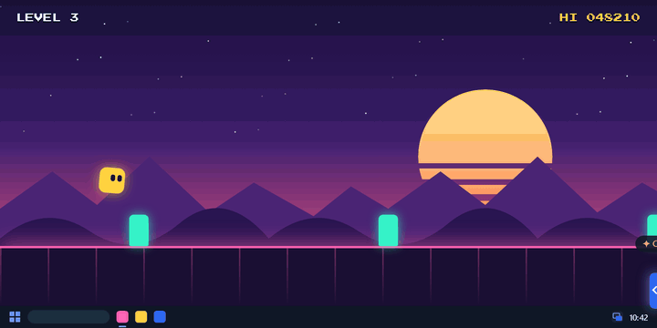
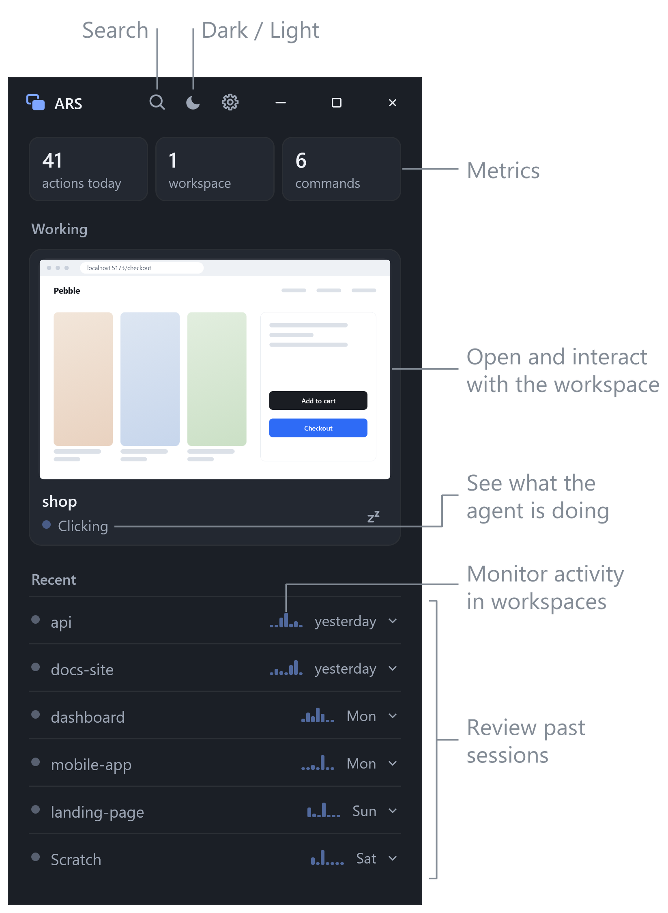
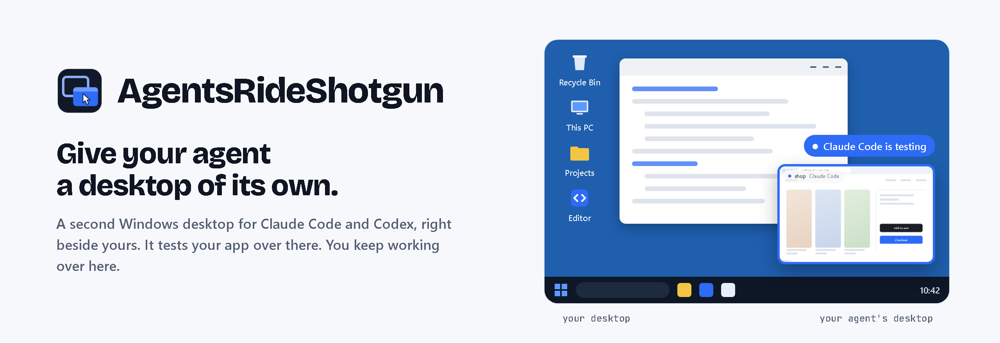

<h1 align="center">AgentsRideShotgun (ARS)</h1>

<p align="center"><strong>A desktop for your agents. On the PC you already use.</strong></p>

ARS gives Claude Code and Codex a separate background Windows desktop for working with local apps, files, and browsers. Keep your own desktop available, watch the agent's workspace, and step in when needed.

Use the agents you already have with the Windows setup where your work lives. The app is free and MIT licensed; your chosen agent's usage costs still apply. [Choose the right environment for your agent's task](AGENT-WORKSPACES.md).

<table>
<tr>
<th width="50%">Without ARS</th>
<th width="50%">With ARS</th>
</tr>
<tr>
<td></td>
<td></td>
</tr>
</table>

<p align="center">The comparison above illustrates the workspace concept. Keep the agent's GUI work in its workspace and follow its progress while you use yours.</p>

ARS runs on the same computer and Windows account, sharing its files, permissions, CPU, and memory. Your AI provider may receive tool output and screenshots. See [Security](SECURITY.md) for the boundary and [task guidance](AGENT-WORKSPACES.md) for when a VM, cloud computer, browser tool, or CLI is a better fit.

---

The current source candidate, ARS 0.3.10, adds [Storage](engine/STORAGE.md): workspace and install usage,
reviewed cleanup, safe retention, and authenticated CLI / MCP reports.
It also supports queued, safe controller restarts and Velopack updates from
the tray or CLI. Running workspaces defer them. See [lifecycle and update
policy](engine/LIFECYCLE.md) for commands, bridge cleanup, and release recovery.

Save work and quit ARS before upgrading with WinGet or running Setup. The
in-app update queue waits for workspaces to stop; external installers have
their own process shutdown behavior.

<p align="center"></p>

<table>
<tr>
<td width="58%" valign="top">

### Install options

1. **Installer**

   [Download **ARS-Setup.exe**](https://github.com/JeffLepp/AgentsRideShotgun/releases/latest/download/ARS-Setup.exe) and run it.

2. **WinGet**

   ```powershell
   winget install --id JeffLepp.AgentsRideShotgun --exact --source winget
   ```

   To update an existing installation:

   ```powershell
   winget upgrade --id JeffLepp.AgentsRideShotgun --exact --source winget
   ```

3. **Build from source**

   Requires the .NET 10 SDK on Windows 10 (build 19041) or later.

   ```powershell
   git clone https://github.com/JeffLepp/AgentsRideShotgun
   cd AgentsRideShotgun
   dotnet build app/ARS.csproj -c Release
   ```

   The built app is `app\bin\Release\net10.0-windows\win-x64\ARS.exe`. Launch it from the repository root:

   ```powershell
   .\app\bin\Release\net10.0-windows\win-x64\ARS.exe
   ```

</td>
<td width="42%" valign="top">

### First run

1. Open ARS and press **Start** to connect your detected agents.
2. Use Claude Code or Codex as usual. ARS tools route GUI work into a workspace automatically. The optional ARS skill can also be discovered automatically for GUI testing. If a chat started before ARS connected, refresh its tools or start a new agent session.

### Windows compatibility

The Windows package targets x64 Windows 10 build 19041 or later and x64 Windows 11. It bundles .NET 10. Supported browsers are Chrome, Edge, Brave, and Vivaldi. Browser work needs one installed, and desktop work needs a signed-in interactive Windows session.

### Your browser and sign-ins

**Settings → General → Separate browser profile** is off by default. ARS connects to your running Chrome, Edge, Brave, or Vivaldi and uses the same sign-ins in its own background tabs. It does not copy your passwords, cookies or browser profile. Click **Connect my browser**, enable remote debugging in the browser's Inspect page, and allow the browser's connection request. Live session access requires a browser version that supports this permission flow, such as Chrome 144 or later. The browser asks permission for each connection.

Turn the setting on to keep a separate browser profile for each workspace. Changes apply when a browser next opens. Agents can use your signed-in sites as you; page content and screenshots may reach your AI provider. ARS is not a sandbox. See [Security](SECURITY.md).

**Browser sign-ins:** Shared sign-ins need your browser open and remote debugging allowed through **Connect my browser**. Otherwise, ARS uses a separate profile and you must sign in there.

Double-click a working card or recent workspace to open it fullscreen; **Esc** returns to the compact strip. **Ctrl+Enter** opens a focused card fullscreen too.

- **Give the workspace its own window.** Open the workspace, then choose **More → Pop out**.
- **Open an app on your desktop.** Hover over an eligible app in the corner preview and click **Open on my desktop**, or drag its title bar out of the preview. Save your work first because ARS relaunches the app. For a browser page, ARS opens its URL on your desktop and leaves the workspace tab open.

</td>
</tr>
</table>

Maintainers: see [Publishing releases and WinGet updates](tools/RELEASING.md).

<p align="center">Anyone can use, modify, and share ARS under the <a href="LICENSE">MIT License</a>.</p>

<p align="center">
  <picture>
    <source media="(prefers-color-scheme: dark)" srcset=".github/readme/banner-dark.png">
    
  </picture>
</p>
