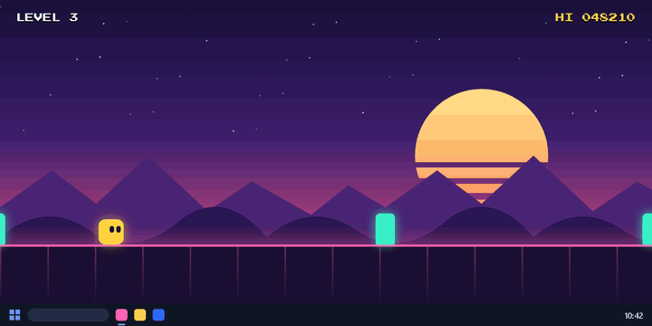
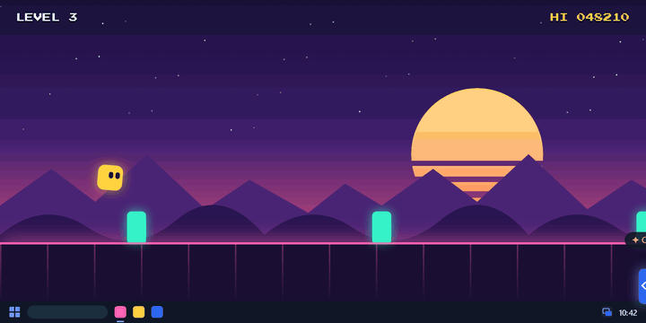
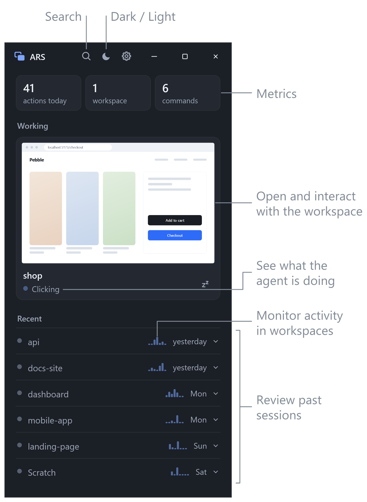
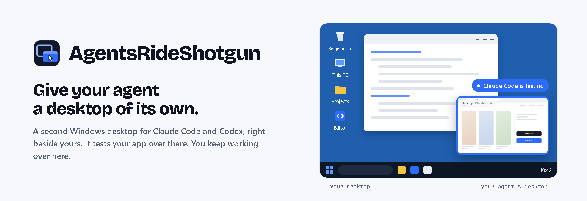

<h1 align="center">AgentsRideShotgun (ARS)</h1>

<table>
<tr>
<th width="50%">Without ARS</th>
<th width="50%">With ARS</th>
</tr>
<tr>
<td></td>
<td></td>
</tr>
</table>

<p align="center"><b>Stop letting agents take the wheel. Give them a desktop of their own and let them ride shotgun.</b> Agents can still perform full computer use while their ARS workspace stays out of your way. Token efficient, all local, and automatic.</p>

---

<p align="center"></p>

<table>
<tr>
<td width="58%" valign="top">

### Install options

1. **Installer**

   [Download **ARS-Setup.exe**](https://github.com/JeffLepp/AgentsRideShotgun/releases/latest/download/ARS-Setup.exe) and run it.

2. **WinGet** (pending Microsoft review)

   ```powershell
   winget install AgentsRideShotgun
   ```

3. **Build from source**

   Requires the .NET 10 SDK on Windows 10 (build 19041) or later.

   ```powershell
   git clone https://github.com/JeffLepp/AgentsRideShotgun
   cd AgentsRideShotgun
   dotnet build app/ARS.csproj -c Release
   ```

</td>
<td width="42%" valign="top">

### First run

1. Open ARS and press **Start** to connect your detected agents.
2. Use Claude Code or Codex as usual. ARS tools route GUI work into a workspace automatically. The optional ARS skill can also be discovered automatically for GUI testing. If a chat started before ARS connected, refresh its tools or start a new agent session.

### Windows compatibility

The Windows package targets x64 Windows 10 build 19041 or later and x64 Windows 11. It bundles .NET 10. Browser work needs an installed Edge or Chrome, and desktop work needs a signed-in interactive Windows session.

### Your browser and sign-ins

**Settings → General → Separate browser profile** is off by default. ARS connects to your running Chrome or Edge and uses the same sign-ins in its own background tabs. It does not copy your passwords, cookies or browser profile. Click **Connect my browser**, enable remote debugging in the browser's Inspect page, and allow the browser's connection request. Live session access requires a browser version that supports this permission flow, such as Chrome 144 or later. The browser asks permission for each connection.

Turn the setting on to keep a separate browser profile for each workspace. Changes apply when a browser next opens. Double-click a working card or recent workspace to open it fullscreen; **Esc** returns to the compact strip. **Ctrl+Enter** opens a focused card fullscreen too.

</td>
</tr>
</table>

<p align="center">Anyone can use, modify, and share ARS under the <a href="LICENSE">MIT License</a>.</p>

<p align="center">
  <picture>
    <source media="(prefers-color-scheme: dark)" srcset=".github/readme/banner-dark.png">
    
  </picture>
</p>
